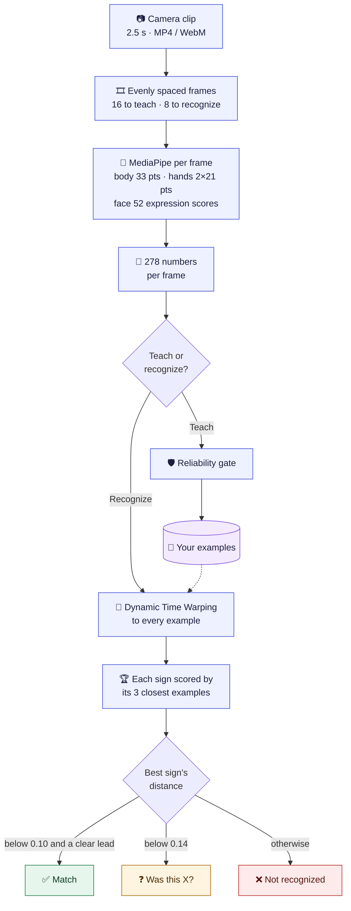
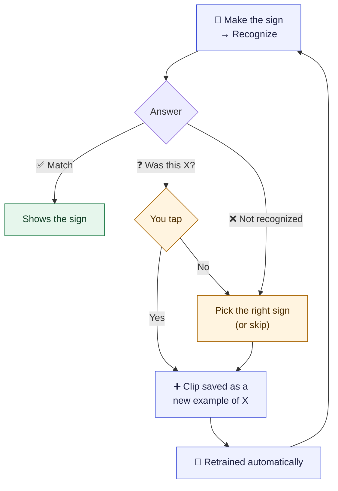
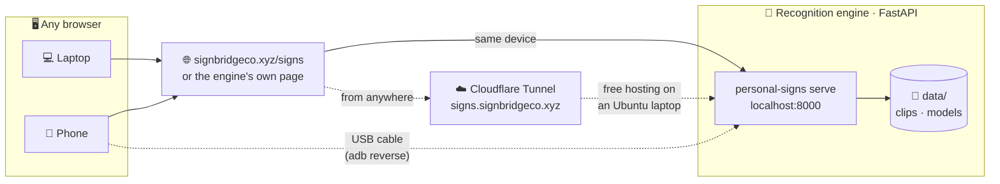
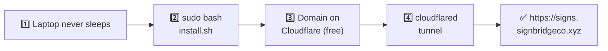

# Personal ISL Signs

**Teach a sign-language recognizer *your* way of signing with a few short clips.**


Most sign-language recognizers learn one fixed vocabulary from other people's
videos, so they struggle with *your* signing: regional Indian Sign Language
variants, a different hand size or speed, or a gesture you invented. This
project flips that around:

1. **You teach it.** Record 3–5 short clips of each sign in the browser.
2. **It checks every clip** before learning from it. Clips with hands out of
   frame or no movement are rejected; doubtful ones need your OK.
3. **It answers honestly:** *match*, *"Was this X?"*, or *not recognized*,
   instead of always guessing.

Everything runs on a normal laptop CPU: about **1.3 s** to save a clip and
**0.7 s** to recognize one.

> Live project site: **https://signbridgeco.xyz**

---

## How it works

### 1. From a clip to a decision



### 2. It keeps learning from your answers



### 3. Where it runs



- **Features:** per frame, 33 body points, 21 points per hand (in fixed
  left/right slots) and 52 face-expression scores. If the face is small in
  full-body framing, the head area is cropped, enlarged and tried again.
- **Matching:** Dynamic Time Warping lines up a sign made faster or slower. The
  frame-distance table is computed at once with NumPy, about 40× faster than
  frame by frame, with the same results.
- **Personal or custom:** each sign is stored either as *your way of an ISL
  sign* or *your own custom gesture*, so a custom gesture is never shown as
  standard ISL.

Details: [docs/how-it-works.md](docs/how-it-works.md) · Research background: [docs/research.md](docs/research.md)

## Quick start

```bash
git clone https://github.com/Lukesh2006/isl-personal-signs.git
cd isl-personal-signs
python -m venv .venv
# Windows: .venv\Scripts\activate    Linux/macOS: source .venv/bin/activate
pip install -e ".[test]"
personal-signs download-models     # MediaPipe pose, hand and face models (~20 MB)
personal-signs serve               # then open http://127.0.0.1:8000
```

In the browser: **Start camera** → type a sign name → **Record example** (3+
times per sign, 2+ signs) → **Train** → **Recognize**. When it asks
*"Was this X?"*, **Yes** adds that clip to X and retrains, so it keeps learning.

The same page is published at **https://signbridgeco.xyz/signs**. It talks to
the engine on the visitor's own device (`http://localhost:8000`, also from a
phone connected by USB) or to a hosted engine set under **Settings → Engine
address**. Allowed websites are set with `PERSONAL_SIGNS_ALLOWED_ORIGINS`.

### Command line

```bash
personal-signs add hello clip1.mp4       # gate and save an example (--confirm to accept a warning)
personal-signs train                     # build the model, with a leave-one-out check
personal-signs recognize test.mp4        # match / confirm / rejected, with the reason
personal-signs list                      # saved signs and each example's gate result
personal-signs tune                      # measure the cut-offs across several signers
```

Add `--user <name>` to keep several people's signs apart.

## Web API

| Method | Path | Body | Result |
|---|---|---|---|
| `GET` | `/health` | | `{"status": "ok"}` |
| `GET` | `/signs` | | saved signs and per-example gate results |
| `POST` | `/signs/{label}?kind=&confirm=` | MP4/WebM bytes | gate decision; saved only if reliable or confirmed |
| `DELETE` | `/signs/{label}/{sample_id}` | | removes an example and rebuilds the model |
| `POST` | `/train` | | signs and clips learned, leave-one-out accuracy |
| `POST` | `/recognize` | MP4/WebM bytes | `decision`, `suggestion`, `reason`, tracking signals |

Headers: `X-User: <profile>` picks the user (default `default`). When
`PERSONAL_SIGNS_API_KEY` is set, every call except `/health` needs
`Authorization: Bearer <key>`; always set it before going online.

## Results so far

| Check | Result |
|---|---|
| Real clips, 2 signs × 3 examples | All 6 passed the gate; leave-one-out **83%** (5/6); 2 unseen clips both recognized as **match** |
| Cut-off study, 1 signer × 4 signs × 16 clips | With the current cut-offs an untaught sign is wrongly accepted **75%** of the time, so more signers are needed before tuning ([details](docs/testing-with-signers.md)) |
| Automated tests | 37 tests: gate, training, bands, closest-example scoring, DTW against a reference version, MP4/WebM decoding, API, API key and website access |

## Self-hosting for free

Run it on a spare Ubuntu laptop behind a free Cloudflare Tunnel, with no
router ports and no paid hosting: [docs/self-hosting-ubuntu.md](docs/self-hosting-ubuntu.md).



```bash
sudo bash deploy/ubuntu/install.sh
```

## Project layout

```text
src/personal_signs/
  landmarks.py   MediaPipe detectors and the 278-number frame features
  engine.py      decoding, reliability gate, DTW, training, recognition
  api.py         FastAPI server + browser demo (static/index.html)
  tuning.py      cut-off measurement across signers
  cli.py         personal-signs command
tests/           37 offline tests (MediaPipe is simulated)
deploy/ubuntu/   installer, systemd service, Cloudflare Tunnel config
docs/            how it works, testing with signers, self-hosting, research
samples/         small standalone code samples (server endpoints, frames, browser recording)
```

## Roadmap

- Record 5+ signers and re-tune the cut-offs with `personal-signs tune`.
- Add a "none of these" class so untaught signs are rejected more reliably.
- Continuous signing: spot signs inside longer recordings.
- Start from a shared ISL vocabulary, then personalize it.

## Privacy

Recordings are personal data. They stay in `data/` on the machine running the
server (git-ignored) and are never uploaded anywhere by this project.

## License

MIT © 2026 [Lukesh2006](https://github.com/Lukesh2006). MediaPipe model files
are downloaded from Google's model storage under their own license.
