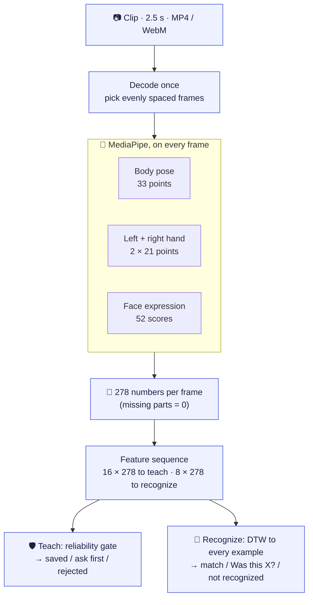
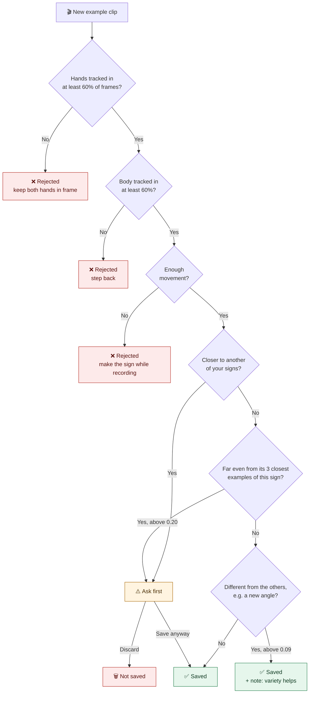
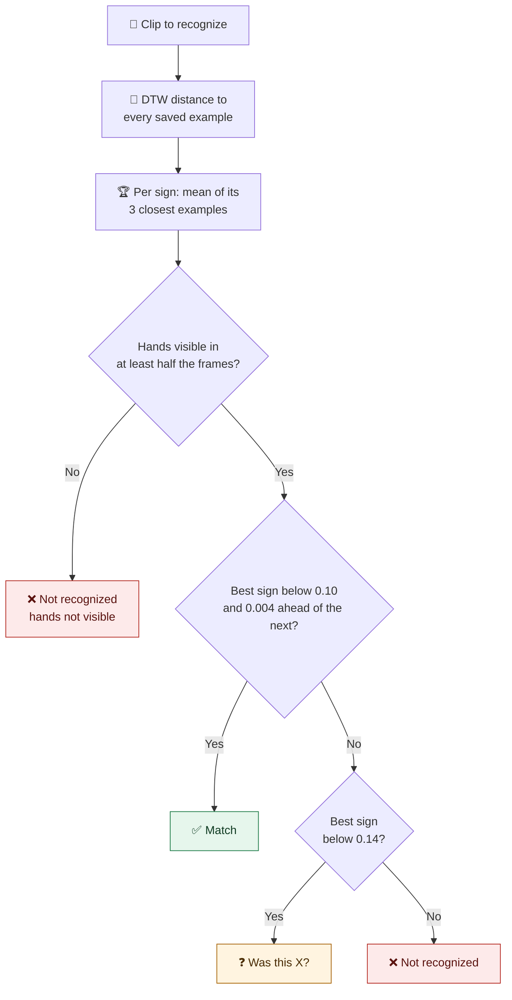

# How it works

## Features (`src/personal_signs/landmarks.py`)

For each sampled frame, three MediaPipe detectors run:

| Part | Values | Notes |
|---|---|---|
| Body pose | 33 points × (x, y, z) | Shoulders, elbows, wrists, head anchors |
| Left hand, right hand | 2 × 21 points × (x, y, z) | Put in fixed left/right slots using MediaPipe's handedness |
| Face expression | 52 blendshape scores | If the face is too small in full-body framing, the head area found by the pose model is cropped, enlarged and tried again |
| Face found | 1 flag | |

Anything not detected stays 0 and counts as "not seen".

## Distance (`engine._pairwise_frame_distances`, `engine.sequence_distance`)

Between two frames:

- **Landmarks:** mean distance between points seen in *both* frames, plus a small
  penalty for points seen in only one (fewer than 5 shared points → fixed 0.35).
- **Face:** when both frames have a face, the result is 70% landmarks + 30% mean
  difference of the 52 expression scores; a face in only one frame adds 0.03.

Between two clips: **Dynamic Time Warping** over the frame-distance table, divided
by (rows + columns), so a sign made faster or slower still lines up. The whole
frame-distance table is computed at once with NumPy, about 40× faster than frame
by frame, with the same results to 1e-7.

## Reliability gate (`engine.assess_sample`)

| Check | Result |
|---|---|
| Hands tracked in < 60% of frames | **Rejected**: keep both hands in frame |
| Body tracked in < 60% of frames | **Rejected**: step back |
| Almost no movement (motion < 0.012) | **Rejected**: make the sign while recording |
| Differs from your other examples of this sign (median > 0.09), e.g. a new angle | **Saved**, with a "variety helps" note |
| Very different even from its 3 closest examples of this sign (> 0.20) | **Needs confirmation** |
| Closer to another of your signs than to this one | **Needs confirmation** |
| First example of a new sign very close (< 0.05) to an existing sign | **Needs confirmation** |

A clip that needs confirmation is only saved when the user says so. Each
example remembers its gate result, and any example can be deleted later; the
trained model is rebuilt (or removed if a sign drops below 3 examples).

## Training (`engine.train_user`)

Training needs **≥ 3 clips for each of ≥ 2 signs**. The model is simply the
saved feature sequences (prototypes). Training also reports a
leave-one-clip-out check, and, if a seed model exists, compares it with the
personal model on the same clips.

## Recognition bands (`engine.predict_user`)

| Condition | Answer |
|---|---|
| Hands visible, nearest sign < 0.10 and clearly ahead of the second (gap > 0.004) | **Match** |
| Hands visible, nearest sign < 0.14 | **"Was this X?"** |
| Otherwise | **Not recognized** (with the reason) |

Each sign's distance is the **mean of its 3 closest examples**, not of all of
them. Averaging over every example penalized signs taught with many varied
clips (different cameras, angles, distances): the more a sign was taught, the
worse it scored. On 24 real clips this raised clear matches from 10 to 15 and
removed every "not recognized".

The answer also lists the three closest signs with their distances, and the
server logs every recognition the same way.

### Learning from answers

When the answer is *"Was this X?"*, **Yes** saves that clip as a new example of
X and retrains; **No** lets the user pick the right sign (or skip). Each answer
adds an example recorded the way the user really signs.

The cut-offs started from one signer's clips. Measure them on several people
with `personal-signs tune` before changing them; see
[testing-with-signers.md](testing-with-signers.md).

## Speed

On a laptop CPU, saving a clip takes about **1.3 s** and recognizing one about
**0.7 s**. The detectors are built once per worker thread and reused, each clip
is decoded in a single pass, and the frames of a clip are analyzed on several
threads.
