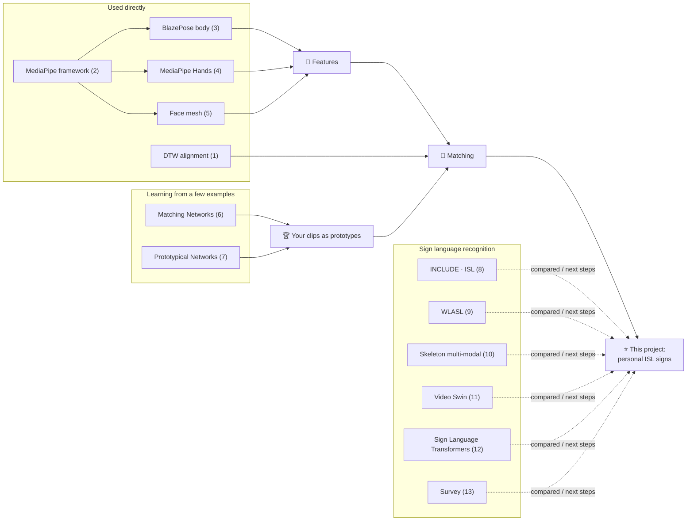

# Research background

Papers this project builds on or compares itself with. Every link was checked
against arXiv or Crossref; follow it for the full paper and its authors.

## Methods used directly

| # | Paper | Venue / year | Link | How it is used here |
|---|---|---|---|---|
| 1 | *Dynamic programming algorithm optimization for spoken word recognition* | IEEE Transactions on Acoustics, Speech, and Signal Processing, 1978 | [doi:10.1109/TASSP.1978.1163055](https://doi.org/10.1109/TASSP.1978.1163055) | The Dynamic Time Warping (DTW) alignment that matches a new clip to saved examples even when the sign is made faster or slower. |
| 2 | *MediaPipe: A Framework for Building Perception Pipelines* | arXiv, 2019 | [arXiv:1906.08172](https://arxiv.org/abs/1906.08172) | The on-device framework that runs the three detectors below. |
| 3 | *BlazePose: On-device Real-time Body Pose tracking* | arXiv, 2020 | [arXiv:2006.10204](https://arxiv.org/abs/2006.10204) | The 33 body points per frame (shoulders, elbows, head anchors). |
| 4 | *MediaPipe Hands: On-device Real-time Hand Tracking* | arXiv, 2020 | [arXiv:2006.10214](https://arxiv.org/abs/2006.10214) | The 21 points per hand for both hands: handshape and movement. |
| 5 | *Attention Mesh: High-fidelity Face Mesh Prediction in Real-time* | arXiv, 2020 | [arXiv:2006.10962](https://arxiv.org/abs/2006.10962) | Background for the face model that gives 52 expression scores; ISL uses facial expression as part of the sign. |

## Learning from a few examples

| # | Paper | Venue / year | Link | Relation |
|---|---|---|---|---|
| 6 | *Matching Networks for One Shot Learning* | NeurIPS, 2016 | [arXiv:1606.04080](https://arxiv.org/abs/1606.04080) | Classifying a new example by comparing it with a handful of labeled ones, the idea behind teaching a sign with 3–5 clips. |
| 7 | *Prototypical Networks for Few-shot Learning* | NeurIPS, 2017 | [arXiv:1703.05175](https://arxiv.org/abs/1703.05175) | Matching against per-class examples ("prototypes"). Here the prototypes are the user's own clips, and the distance is DTW over pose, hand and face features instead of a learned embedding. |

## Sign language recognition

| # | Paper | Venue / year | Link | Relation |
|---|---|---|---|---|
| 8 | *INCLUDE: A Large Scale Dataset for Indian Sign Language Recognition* | ACM Multimedia, 2020 | [doi:10.1145/3394171.3413528](https://doi.org/10.1145/3394171.3413528) | A large ISL word dataset; a natural next step for a shared (not only personal) vocabulary. |
| 9 | *Word-level Deep Sign Language Recognition from Video: A New Large-scale Dataset and Methods Comparison* | WACV, 2020 | [arXiv:1910.11006](https://arxiv.org/abs/1910.11006) | Compares appearance-based and pose-based word recognition; pose-based models need far less compute, as here. |
| 10 | *Skeleton Aware Multi-modal Sign Language Recognition* | CVPR Workshops, 2021 | [arXiv:2103.08833](https://arxiv.org/abs/2103.08833) | Shows how much body/hand skeleton features carry, combined with other inputs. |
| 11 | *Video Swin Transformer* | CVPR, 2022 | [arXiv:2106.13230](https://arxiv.org/abs/2106.13230) | A large video model for many-word recognition; the heavyweight alternative to this lightweight personal approach. |
| 12 | *Sign Language Transformers: Joint End-to-end Sign Language Recognition and Translation* | CVPR, 2020 | [arXiv:2003.13830](https://arxiv.org/abs/2003.13830) | Continuous sentence-level recognition and translation, beyond isolated signs (future work). |
| 13 | *Quantitative Survey of the State of the Art in Sign Language Recognition* | arXiv, 2020 | [arXiv:2008.09918](https://arxiv.org/abs/2008.09918) | Survey of datasets, signer-independent evaluation and open problems; motivates testing across several signers. |

## What this project adds

- **Personalization first:** instead of one model for everyone, each user teaches
  their own way of signing (or a custom gesture) with a few clips.
- **A reliability gate:** bad examples (hands not tracked, no movement) are
  rejected before they can hurt recognition; doubtful ones need the user's OK.
- **Honest answers:** the recognizer says *match*, *"Was this X?"* or
  *not recognized* instead of always guessing.
- **Measurement:** `personal-signs tune` reports how often an untaught sign
  would be wrongly accepted, across signers, before cut-offs are changed.
