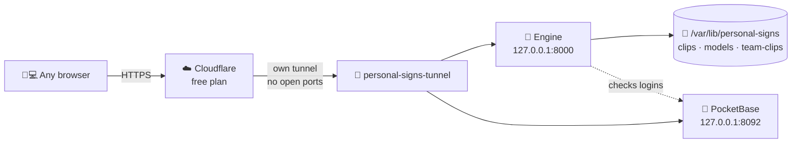
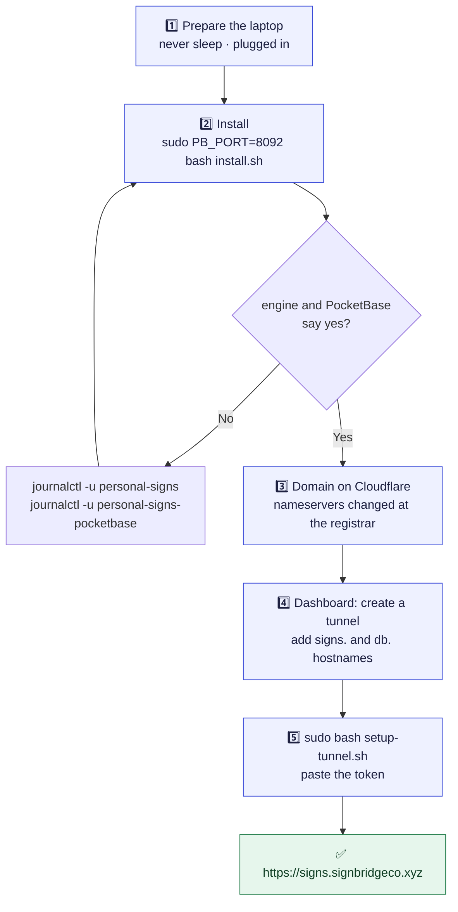

# Self-hosting on an Ubuntu laptop (free)

Run the server on a spare Ubuntu / Linux Mint laptop and make it reachable at
`https://signs.signbridgeco.xyz` (training site) and `https://db.signbridgeco.xyz`
(accounts) through a free Cloudflare Tunnel. No router ports are opened and no
static IP is needed.



### The whole setup at a glance



## Sharing the machine with other projects

Everything here has its own names, folders and port, so another project on the
same laptop (its own PocketBase, its own `cloudflared` service and
`/etc/cloudflared` config) is **never read, changed or restarted**:

| This project | Name / place |
|---|---|
| Services | `personal-signs`, `personal-signs-pocketbase`, `personal-signs-tunnel`, `personal-signs-backup.timer` |
| Code | `/opt/personal-signs`, `/opt/personal-signs-pocketbase`, `/opt/personal-signs-tunnel` (its own checksum-verified cloudflared; the machine's cloudflared is never used or updated) |
| Data | `/var/lib/personal-signs`, `/var/lib/personal-signs-pocketbase` |
| Settings | `/etc/personal-signs` (the tunnel uses its own empty `cloudflared.yml` here) |
| Ports | engine 8000, PocketBase 8092 (choose with `PB_PORT`) |

Never run `cloudflared service install` or `cloudflared tunnel login` for this
project: both would use the machine-wide cloudflared files of another project.

Extra safety built in:
- Our services cannot even see `/etc/cloudflared` or any home folder (`~/.cloudflared`).
- `apt-get install --no-upgrade`: only missing packages are added; nothing another
  program uses is upgraded.
- `install.sh` and `setup-tunnel.sh` end by reporting whether any **other** running
  service was restarted or stopped; the expected line is
  "Other services on this machine: none restarted or stopped (untouched)."
- `setup-tunnel.sh` shows the tunnel ID inside the token and waits for `yes`, so a
  token from another project's tunnel is not used by mistake.

## 1. Prepare the laptop

1. Stop it from sleeping (Cinnamon: **System Settings → Power Management**):
   *Suspend when inactive* → **Never** (on AC power); *When the lid is closed* → **Do nothing**.
2. Keep it plugged in, ideally on a cable network.

## 2. Install the server

```bash
sudo apt install -y git
git clone https://github.com/Lukesh2006/isl-personal-signs.git ~/isl-personal-signs
sudo PB_PORT=8092 bash ~/isl-personal-signs/deploy/ubuntu/install.sh
```

The installer stops without changing anything if a port is already used by another
program. It installs the engine and this project's own PocketBase, starts both after
every reboot, and keeps a daily backup. Then create the PocketBase admin (choose a
strong password):

```bash
sudo -u personal-signs-pocketbase /opt/personal-signs-pocketbase/pocketbase \
  superuser upsert YOUR_EMAIL 'YOUR_PASSWORD' --dir /var/lib/personal-signs-pocketbase/pb_data
```

## 3. Domain on Cloudflare

Add the domain at <https://dash.cloudflare.com> (free plan) and change the
registrar's nameservers to the two Cloudflare shows. Keep website records
**DNS only** if the site is hosted elsewhere (for example on Vercel).

## 4. Create this project's tunnel (dashboard)

**Zero Trust → Networks → Tunnels → Create a tunnel → Cloudflared**, name it
`signbridge`. On the install page, copy the long token from the command shown, but
**do not run that command**. Then add two public hostnames (use `127.0.0.1`, not `localhost`: cloudflared may try IPv6 `::1`, where these services do not listen):

| Subdomain | Domain | Service |
|---|---|---|
| `signs` | `signbridgeco.xyz` | `HTTP` · `127.0.0.1:8000` |
| `db` | `signbridgeco.xyz` | `HTTP` · `127.0.0.1:8092` |

## 5. Connect it

```bash
sudo bash ~/isl-personal-signs/deploy/ubuntu/setup-tunnel.sh   # paste the token when asked
```

From any device: open `https://signs.signbridgeco.xyz`, sign up, record a sign.

## Everyday commands

| Task | Command |
|---|---|
| Update to the latest version | `cd ~/isl-personal-signs && git pull && sudo PB_PORT=8092 bash deploy/ubuntu/install.sh` |
| Server logs | `sudo journalctl -u personal-signs -f` |
| Tunnel logs | `sudo journalctl -u personal-signs-tunnel -f` |
| Restart | `sudo systemctl restart personal-signs` |
| Accounts admin | `https://db.signbridgeco.xyz/_/` |

## Security notes

- The engine and PocketBase listen on `127.0.0.1` only; the tunnel is the only way in.
- Every API call needs a PocketBase login token; each account sees only its own signs.
- The tunnel token in `/etc/personal-signs/tunnel.env` is readable only by root and the service.
- Recordings are personal data (faces). Readable copies by name are in
  `/var/lib/personal-signs/team-clips`; delete a person's folder there and under
  `data/training_samples/` if they ask.
