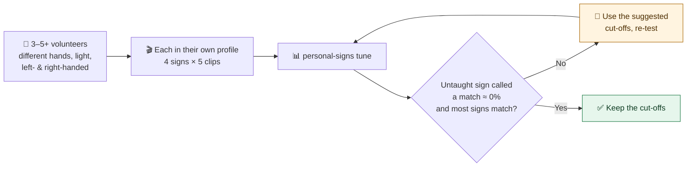
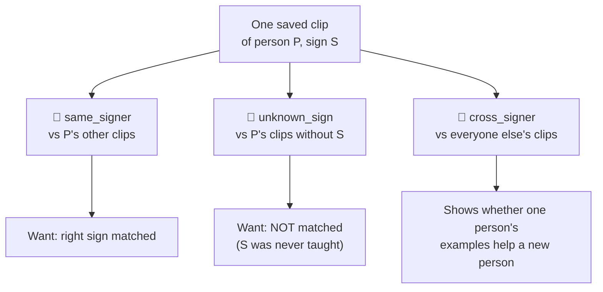

# Testing with more signers

The cut-offs that decide **match / "Was this X?" / not recognized**
(`ACCEPT_DISTANCE`, `ACCEPT_GAP`, `CONFIRM_DISTANCE` in
`src/personal_signs/engine.py`) were first set from 16 clips of one signer.
Before changing them, record several people and measure.



### The three tests



## 1. Record

For each volunteer (aim for **at least 5 people**, with different hand sizes,
skin tones, lighting, and left- and right-handed signers):

1. Open the demo page (`personal-signs serve`, then http://127.0.0.1:8000).
2. Under **Settings**, set a different **profile name** for each person.
3. Record **at least 4 signs with 5 clips each**, using the same sign names for
   everyone (e.g. `hello`, `thank_you`, `good_morning`, `yes`, `no`).
4. Frame head to waist with both hands visible, and vary distance and
   background a little between clips.

Clips are saved under `data/training_samples/<profile>/<sign>/`. They are
personal data: `data/` is git-ignored and never uploaded.

## 2. Measure

```bash
personal-signs tune
```

| Test | What it checks | Want |
|---|---|---|
| `same_signer` | A person's sign against their own other clips | High correct match, ~0% wrong match |
| `unknown_sign` | A sign the recognizer was never taught | ~0% called a match |
| `cross_signer` | A person's sign against other people's clips | Shows whether one person's examples help a new person |

`--max-false-match 0.01` sets a stricter target; `--exact` re-reads the 8-frame
live queries from video (slower, closest to real use). The full report is
written to `data/personal_models/threshold_report.json`.

## 3. Change the cut-offs

Only when the report covers 3–5 or more signers: copy the suggested values into
`engine.py`, run the tests, and try the demo again.

## First result (1 signer, 4 signs, 16 clips)

| Cut-offs (accept / gap / maybe) | Correct match | Wrong match | Untaught sign called a match |
|---|---|---|---|
| Current (0.10 / 0.004 / 0.14) | 75% | 12% | **75%** |
| Strict (0.06 / 0.004 / 0.075) | 6% | 0% | 0% |

On this data, distance alone does not separate right from wrong: the current
values let most untaught signs through, while strict values reject almost
everything. More signers are needed before choosing; a learned distance or a
"none of these" example class are possible next steps.
