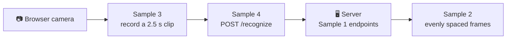

# Code samples

Small, self-contained examples of the building blocks this project uses. They
are general-purpose snippets you can run on their own.

| File | What it shows |
|---|---|
| [`server_endpoints.py`](server_endpoints.py) | Sample 1: basic FastAPI endpoints (`/health`, `/config`) |
| [`sample_frames.py`](sample_frames.py) | Sample 2: picking evenly spaced frames from a video with OpenCV |
| [`record_and_send.js`](record_and_send.js) | Samples 3 and 4: recording a short clip in the browser and sending it to the server |

